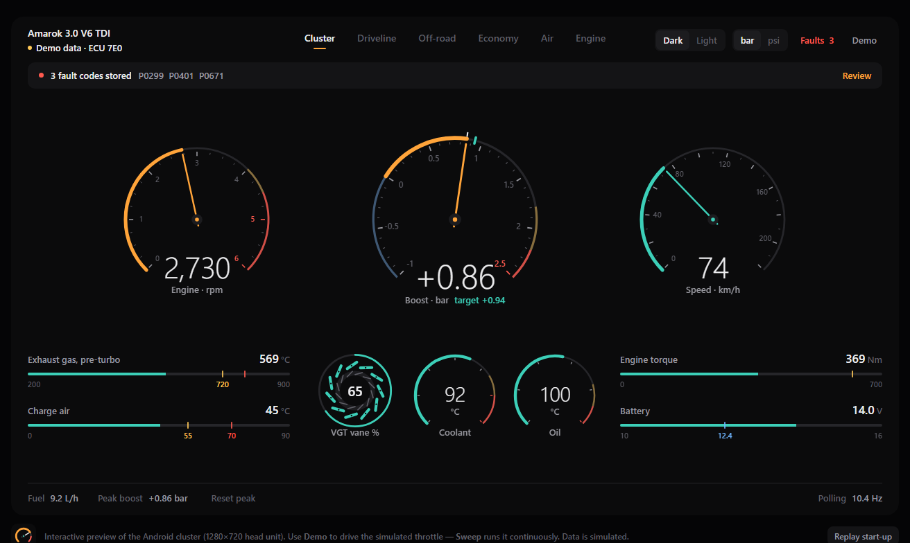
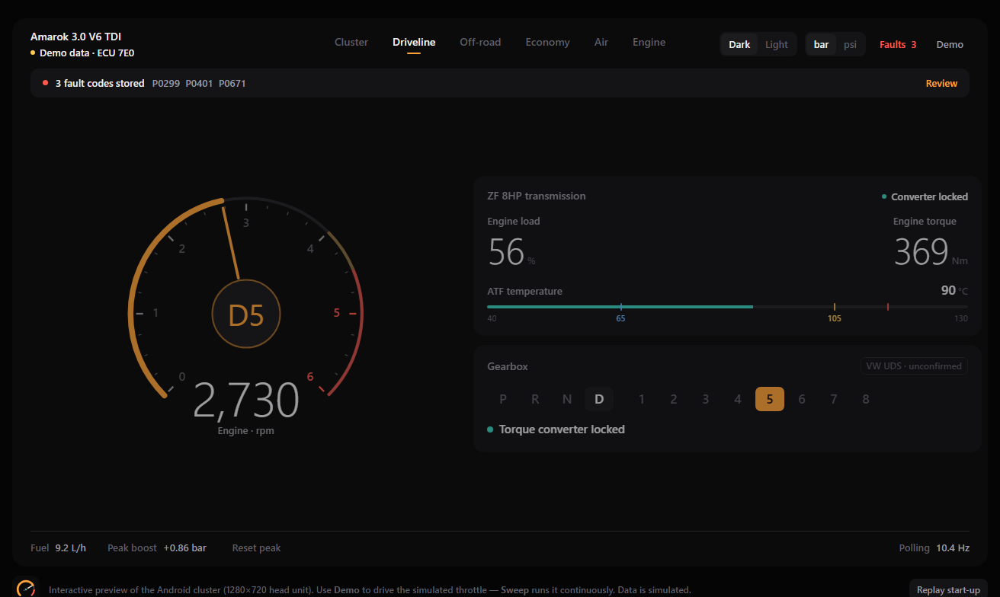
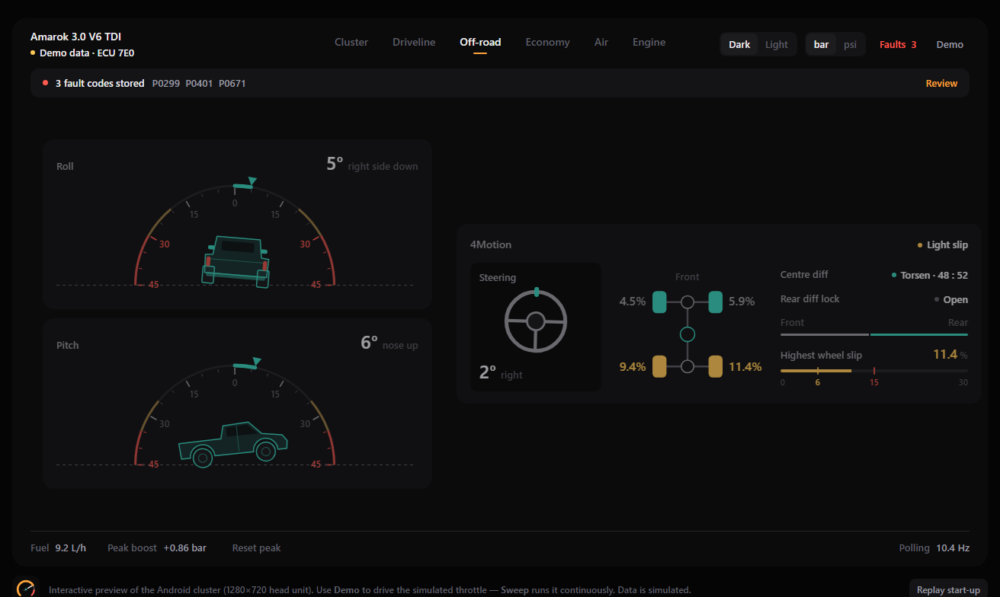
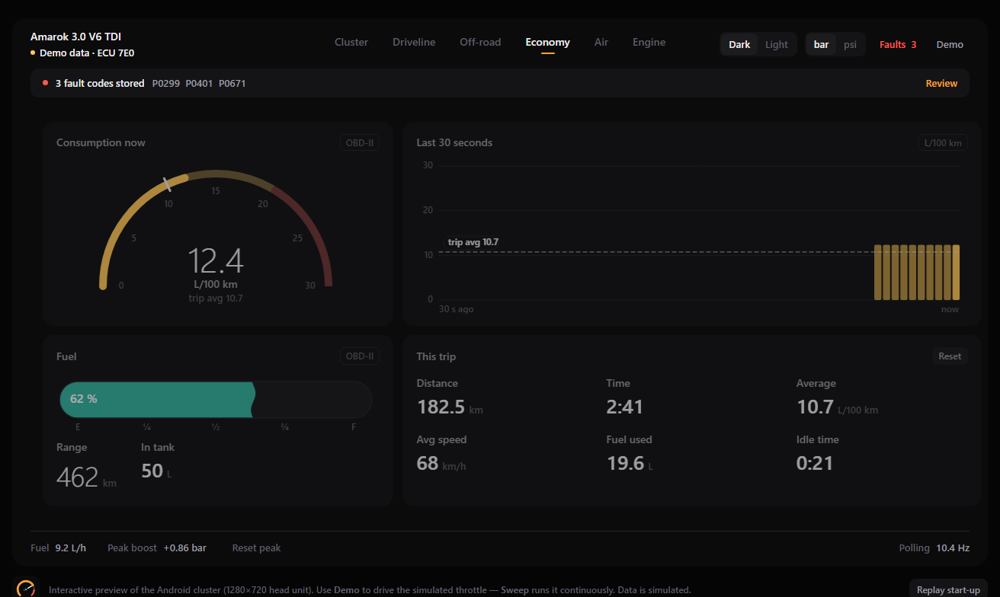
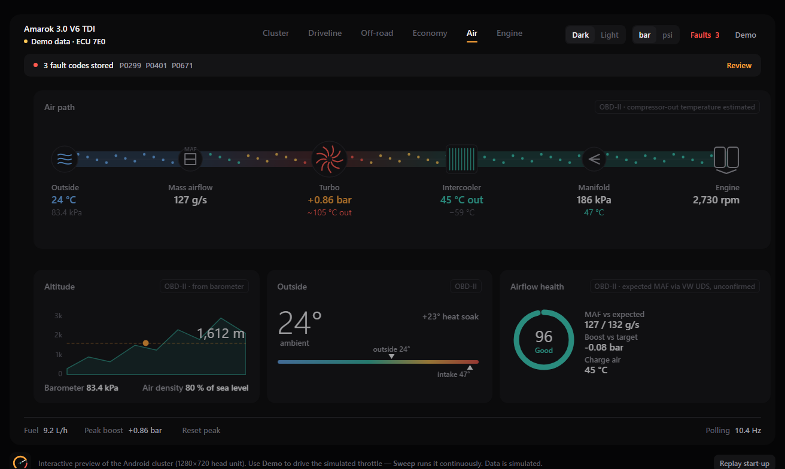
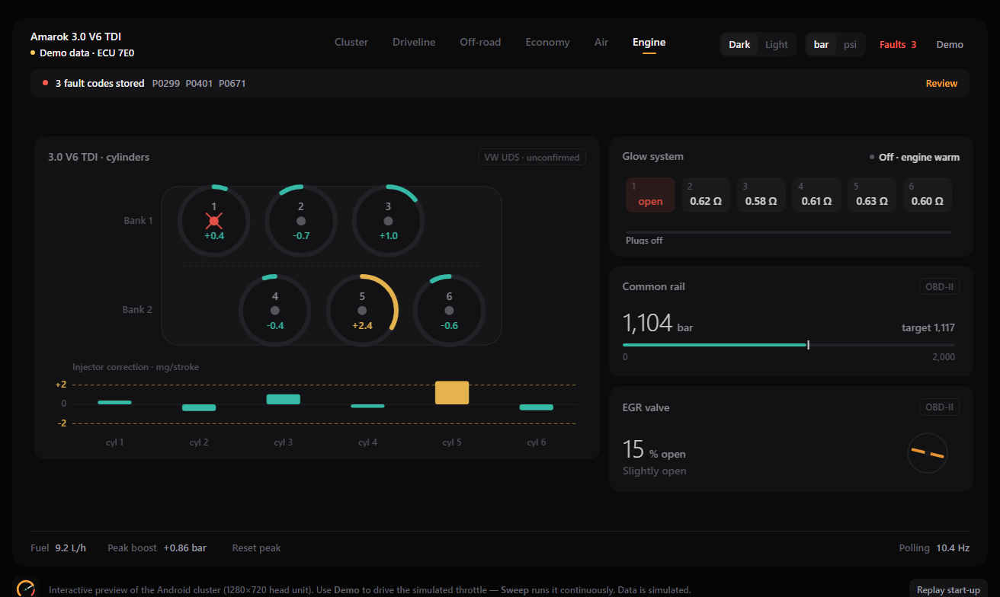
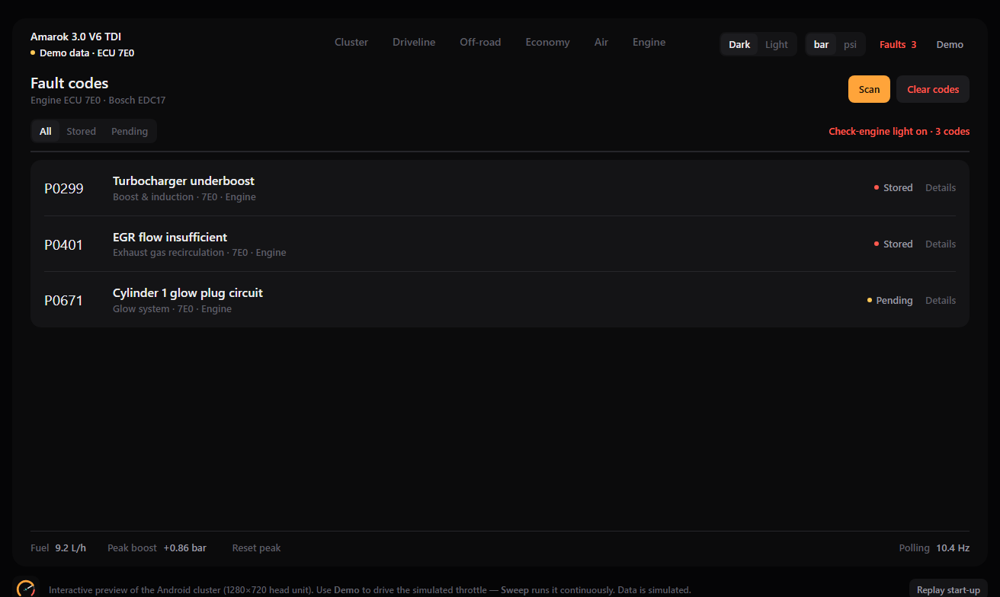

# Project Ingwe 🐆

**A glanceable digital cluster for the VW Amarok 3.0 V6 TDI** — boost, turbo, ZF 8HP and 4Motion telemetry over OBD-II / UDS, built for 1280×720 landscape Android head units (Unisoc UIS8581A / TS18 / OYIN).

Kotlin · Jetpack Compose · custom Canvas gauges · read-only by design



> **Status — milestone M1 (v0.4.1).** Six pages are complete and run on simulated data (use **Demo** in the header to drive the throttle). The OBD polling pipeline (ELM327 driver, ISO-TP, poll scheduler) is built and tested against a mock adapter; the BLE transport lands in M3.
> Try it in a browser first: open [`docs/mockup.html`](docs/mockup.html) — it mirrors the Android screens (add `?tab=economy`, `air` or `engine` to jump to a page).

---

## Contents

- [Screens](#screens)
- [Design](#design)
- [Safety](#safety)
- [Signals](#signals)
- [Build and test](#build-and-test)
- [Install on the head unit](#install-on-the-head-unit)
- [Recommended adapters](#recommended-adapters)

---

## Screens

### Cluster

The main screen (shown at the top): three primary dials, three sub-dials and four bar meters.

| Readout | Range | Notes |
|---|---|---|
| Tachometer | 0 – 6,000 rpm | Caution from 4,000, redline from 4,500 |
| Boost | −1.0 – +2.5 bar / −15 – +35 psi | Tap **bar / psi** to switch. Vacuum in blue, overboost in red, peak-hold mark |
| Speedometer | 0 – 220 km/h | |
| VGT vane | 0 – 100 % | Drawn as the turbo's nozzle ring — vanes pivot from closed (tangential) to open (radial) |
| Coolant / Oil | 40 – 130 °C / 40 – 150 °C | Blue until operating temperature, then teal; amber and red near the limit |
| EGT pre-turbo | 200 – 900 °C | Caution 720 °C, alert 780 °C |
| Charge air | 0 – 90 °C | Caution 55 °C, alert 70 °C |
| Engine torque, battery | 0 – 650 Nm, 10 – 16 V | |

### Driveline (ZF 8HP)



- **Gear** — large indicator (`D1`–`D8`, `S1`–`S8`, `R`, `N`, `P`).
- **Converter lockup** — locked, slipping or open.
- **ATF temperature** — from the TCM at `0x7E1`; caution 105 °C, alert 115 °C.
- **Engine torque, coolant and oil** alongside.

### Off-road (4Motion)



- **Steering** — a wheel graphic that turns with the real steering angle.
- **Pitch and roll** — side-view and rear-view truck silhouettes tilt against a level line, turning amber and red as the angle grows (pitch 25° / 35°, roll 20° / 30°).
- **Drivetrain diagram** — top-down chassis with each wheel coloured by its slip (teal < 6 %, amber < 15 %, red above).
- **Differentials** — Torsen centre diff with the live front:rear torque split, and rear diff lock state.

> Per-wheel slip, rear-lock state and torque split are simulated in M1; their UDS identifiers are not yet in `signals.json`.

### Economy



- **Consumption now** — arc gauge in L/100 km (0 – 30) with the trip average marked.
- **Last 30 seconds** — rolling bar history against the trip average.
- **Fuel** — tank level, estimated range and litres remaining.
- **This trip** — distance, time, average, average speed, fuel used and idle time. **Reset** starts a new trip.

### Air



- **Air path** — animated flow from outside air through MAF, turbo, intercooler and manifold to the engine, coloured by temperature.
- **Altitude** — estimated from the barometer, with barometric pressure and air density versus sea level.
- **Outside** — ambient temperature and heat soak (intake air against outside air).
- **Airflow health** — a 0 – 100 score comparing measured MAF to expected, plus boost versus target and charge-air temperature.

> Compressor-out temperature is estimated, and the expected-MAF figure needs a VW UDS identifier that isn't confirmed yet.

### Engine



- **Cylinders** — V6 layout with per-cylinder injector correction (mg/stroke) and a balance chart; amber and red as a cylinder drifts from the others.
- **Glow system** — per-plug resistance, open-circuit detection and heater phase.
- **Common rail** — pressure against target (0 – 2,000 bar).
- **EGR valve** — percent open, with a butterfly-valve symbol that rotates as it opens.

> Injector corrections and glow-plug resistance come from VW UDS identifiers that are unconfirmed; the page shows them as unavailable until the ECU answers.

### Fault codes



- Stored, pending and permanent codes from the engine ECU (`0x7E0`, Bosch EDC17).
- Tap a code for its freeze frame and common Amarok causes.
- **Clear codes** asks for confirmation first (see [Safety](#safety)).
- The cluster shows a quiet banner and a red **Faults** count while any code is stored.

---

## Design

- **Colour means something.** Greys carry the layout. Amber marks the hero dials and the active tab; teal means "in normal range"; blue is cold or vacuum; amber-yellow is caution; red is over the limit.
- **Numbers don't jump.** All readouts use tabular figures.
- **No chrome.** No glows, gradients or coloured borders — space and hairlines group things.

Theme tokens live in [`Theme.kt`](app/src/main/java/io/ingwe/dash/ui/theme/Theme.kt); gauges in [`ui/components/gauges/`](app/src/main/java/io/ingwe/dash/ui/components/gauges).

---

## Safety

Ingwe is a **read-only** tool. Every command passes through [`TransportGuard`](app/src/main/java/io/ingwe/dash/data/transport/TransportGuard.kt) before it reaches the adapter:

- Only these services are allowed: `01` live data, `03` / `07` / `0A` fault codes, `09` vehicle info, UDS `19` read DTCs and `22` read data.
- Write, reset, security-access, routine and actuator services are rejected.
- Clearing codes (`04`, UDS `14`) is blocked until explicitly unlocked, and the UI confirms before clearing.
- Whitespace is stripped first (the ELM327 ignores it, so `0 4` is Mode 04), and malformed input is rejected rather than passed through.

[`TransportAllowlistTest`](app/src/test/java/io/ingwe/dash/TransportAllowlistTest.kt) covers each rule.

---

## Signals

Defined in [`app/src/main/assets/signals.json`](app/src/main/assets/signals.json). Adding a signal needs no code change. `A`–`D` are the response data bytes.

| ID | Signal | ECU | Svc | PID / DID | Formula | Unit | Range | Verified |
|---|---|---|---|---|---|---|---|:---:|
| `rpm` | Engine speed | 7E0 | 01 | 0C | `((A*256)+B)/4` | rpm | 0 – 6000 | ✓ |
| `vehicle_speed` | Speed | 7E0 | 01 | 0D | `A` | km/h | 0 – 220 | ✓ |
| `boost_actual` | Manifold pressure | 7E0 | 01 | 0B | `A` | kPa abs | 0 – 255 | ✓ |
| `boost_target` | Boost target | 7E0 | 01 | 70 | `((B*256)+C)*0.03125` | kPa abs | 0 – 400 | – |
| `engine_torque` | Engine torque | 7E0 | 01 | 62 | `(A-125)*5.8` | Nm | 0 – 700 | – |
| `engine_load` | Engine load | 7E0 | 01 | 04 | `A*100/255` | % | 0 – 100 | ✓ |
| `maf` | Mass airflow | 7E0 | 01 | 10 | `((A*256)+B)/100` | g/s | 0 – 400 | ✓ |
| `turbo_vgt` | VGT vane position | 7E0 | 01 | 71 | `C*100/255` | % | 0 – 100 | – |
| `egt_pre_turbo` | EGT pre-turbo | 7E0 | 01 | 78 | `((B*256)+C)/10-40` | °C | 0 – 1000 | ✓ |
| `fuel_rate` | Fuel rate | 7E0 | 01 | 5E | `((A*256)+B)*0.05` | L/h | 0 – 50 | ✓ |
| `coolant_temp` | Coolant | 7E0 | 01 | 05 | `A-40` | °C | −40 – 130 | ✓ |
| `oil_temp` | Oil | 7E0 | 01 | 5C | `A-40` | °C | −40 – 160 | ✓ |
| `intake_air_temp` | Intake air | 7E0 | 01 | 0F | `A-40` | °C | −40 – 100 | ✓ |
| `charge_air_temp` | Charge air | 7E0 | 01 | 77 | `B-40` | °C | −20 – 120 | ✓ |
| `battery_voltage` | Battery | 7E0 | 01 | 42 | `((A*256)+B)/1000` | V | 10 – 16 | ✓ |
| `fuel_level` | Fuel level | 7E0 | 01 | 2F | `A*100/255` | % | 0 – 100 | – |
| `baro` | Barometer | 7E0 | 01 | 33 | `A` | kPa | 50 – 110 | ✓ |
| `ambient_temp` | Ambient | 7E0 | 01 | 46 | `A-40` | °C | −40 – 60 | – |
| `fuel_rail` | Fuel rail pressure | 7E0 | 01 | 23 | `((A*256)+B)/10` | bar | 0 – 2000 | ✓ |
| `egr_commanded` | EGR commanded | 7E0 | 01 | 2C | `A*100/255` | % | 0 – 100 | ✓ |
| `trans_fluid_temp` | ATF temperature | 7E1 | 22 | 11A8 | `A-40` | °C | 0 – 150 | – |
| `trans_gear` | Current gear | 7E1 | 22 | 1002 | `A` | gear | 1 – 8 | – |
| `trans_lockup` | Converter lockup | 7E1 | 22 | 1003 | `A` | state | 0 – 2 | – |
| `steering_angle` | Steering angle | 7E2 | 22 | 0250 | `((A*256)+B)*0.1-540` | ° | −540 – 540 | – |
| `pitch_angle` | Pitch | 7E2 | 22 | 0252 | `A-45` | ° | −45 – 45 | – |
| `roll_angle` | Roll | 7E2 | 22 | 0253 | `A-45` | ° | −45 – 45 | – |

Signals marked – haven't been confirmed on a real ECU yet.

---

## Build and test

Requirements: JDK 17 and the Android SDK (compile SDK 35, min SDK 31).

```powershell
.\gradlew.bat assembleDebug
```

```powershell
.\gradlew.bat testDebugUnitTest
```

The APK is written to `app/build/outputs/apk/debug/app-debug.apk`. Unit tests cover ISO-TP reassembly, response parsing, formula evaluation, the mock adapter and the safety allowlist.

---

## Install on the head unit

No ADB or developer options needed — a USB stick is enough.

1. **Prepare the stick.** Format a USB drive as **FAT32** (most reliable on these radios) and copy `app-debug.apk` to its root.
2. **Plug it in.** Wait for a "USB drive connected" or "storage mounted" notice.
3. **Install.** Open the radio's file manager (it may be called *Files*, *File Explorer* or *ApkInstaller*), pick the USB drive, tap `app-debug.apk`, then **Install**.
4. **Allow the source if asked.** If Android says it can't install unknown apps from this source, tap **Settings**, turn on **Allow from this source**, go back and tap **Install** again.
5. **Open** — the cluster starts in landscape and keeps the screen on.

<details>
<summary>Factory-menu passwords for UIS8581A / OYIN / TS18 units</summary>

If a system menu asks for a code, try: `8888`, `3368`, `1234`, `123456`, `1617`, `16176699`, `0000`.

</details>

---

## Recommended adapters

| Adapter | Link | Why |
|---|---|---|
| Vgate vLinker MC+ | Bluetooth LE | Handles the Amarok CAN bus and multi-frame UDS well |
| Vgate vLinker FS | Wired USB | Plugs into the head unit directly — no Bluetooth latency |
| OBDLink CX / MX+ | Bluetooth LE | High throughput, stable command pipelining |
