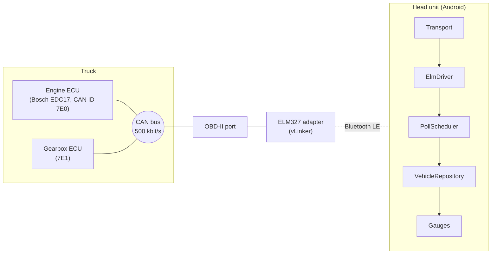

# How Ingwe works

A guided tour of everything between the OBD port under your dash and the needle moving on the screen, written so you can learn it, not just read it. Each section ends with **where it lives in the code**.

---

## 1. The big picture



In one sentence: the app sends short text commands to the adapter over Bluetooth, the adapter turns them into CAN messages for the engine computer, the computer replies with raw bytes, and the app decodes those bytes into numbers and draws them.

---

## 2. The hardware layers

### The CAN bus
Modern cars connect their computers (ECUs) on a **CAN bus**: two twisted wires on which every module can broadcast short messages. Each message has an **ID** (who it's for or from) and up to **8 data bytes**. The Amarok's diagnostic bus runs at 500 kbit/s with 11-bit IDs.

For diagnostics there's a fixed address plan:

| Module | We send to | It replies from |
|---|---|---|
| Engine ECU | `7E0` | `7E8` |
| Gearbox (TCM) | `7E1` | `7E9` |
| Other modules (ABS, etc.) | `7E2`… | `7EA`… |

The reply ID is always the request ID **+ 8**.

### The ELM327 adapter
Your phone or head unit can't speak CAN directly. The **ELM327** (the vLinker is a high-quality ELM-compatible chip) is a translator: you send it **text** like `010C`, it puts the right CAN frame on the bus, and sends the reply back as text like `7E8 04 41 0C 1A F8`. Every reply ends with a `>` prompt, meaning "ready for the next command".

### Bluetooth LE
The adapter shows up as a Bluetooth LE device with a "UART" service: one characteristic we **write** commands to, and one that **notifies** us of reply bytes. That's the `Transport`. It's still a stub (milestone M3); everything above it is real and tested against a simulated adapter.

> **Code:** `data/transport/Transport.kt`, `BleTransport.kt`, `MockTransport.kt`

---

## 3. Talking to the adapter

### Setup: the init sequence
When we connect, `ElmDriver.connect()` sends:

| Command | Meaning | Why we want it |
|---|---|---|
| `ATZ` | Reset | Known starting state; reply tells us the chip version |
| `ATE0` | Echo off | Otherwise every command is sent back to us: wasted bytes |
| `ATL0` | Line feeds off | One less byte per line |
| `ATS0` | Spaces off | `7E8 04 41 0C 1A F8` becomes `7E804410C1AF8`: **~30 % fewer bytes** over Bluetooth |
| `ATH1` | Headers on | Shows the CAN ID, needed to stitch long replies together (section 5) |
| `ATSP6` | Protocol 6 = CAN 11-bit 500k | Skips the slow "SEARCHING…" auto-detect |
| `ATCAF1` | CAN auto-formatting | Adapter handles frame padding for us |
| `ATAT2` | Aggressive adaptive timing | Adapter learns how fast the ECU answers and stops waiting sooner |
| `ATSH7E0` + `ATCRA7E8` | Talk to / listen to the engine only | Other modules stay quiet, fewer stray replies |

### Battery voltage without the engine computer
`ATRV` asks the **adapter itself** to measure the voltage on OBD pin 16 (permanent battery feed). No ECU is involved, so it **works with the ignition off**. That's how the app shows battery voltage while the truck is parked.

> **Code:** `data/elm/ElmDriver.kt`

---

## 4. OBD-II: asking for a value

### Modes and PIDs
A standard request is two parts: a **mode** (also called service) and a **PID** (parameter ID).

- Mode `01` = "current live data"
- PID `0C` = engine speed

So we send `010C`. The ECU replies with mode + `0x40` (`41`), the PID echoed (`0C`), then the data bytes.

### Worked example: engine speed
```
Request:  01 0C
Reply:    7E8 04 41 0C 1A F8
          │   │  │  │  └──┴─ data bytes: A = 0x1A (26), B = 0xF8 (248)
          │   │  │  └─ PID echoed
          │   │  └─ 0x01 + 0x40 = positive response to mode 01
          │   └─ 4 bytes follow (single-frame length)
          └─ from the engine ECU
```
The SAE J1979 standard says RPM = `((A×256)+B)/4` = `((26×256)+248)/4` = **1,726 rpm**.

Every signal is defined that way in **`app/src/main/assets/signals.json`**: ID, ECU, mode, PID, formula, unit, range. Adding a signal needs no code change.

### Formulas are compiled once
The poller evaluates ~20 formulas about 10 times a second. Re-reading the text each time would allocate memory and burn CPU on a weak head unit. So at startup each formula is **parsed into a small expression tree** (`Formula.compile`), and evaluating it is a few multiplications with **zero memory allocation**. If a reply is too short for a formula (it needs byte C but only got 2 bytes), the result is "no value", never a wrong value.

> **Code:** `data/obd/Formula.kt`, `ObdResponseParser.kt`, `assets/signals.json`

---

## 5. Long replies: ISO-TP

A CAN frame holds 8 bytes. Longer answers (exhaust temperature is 9 data bytes, the VIN is 20) are split using **ISO-TP** (ISO 15765-2). The first nibble of each frame's first byte says what kind of frame it is:

| First byte | Frame | Meaning |
|---|---|---|
| `0n` | Single frame | `n` bytes follow; the whole message fits |
| `1n nn` | First frame | Total length is 12 bits (`n nn`); first 6 bytes of data |
| `2n` | Consecutive frame | Sequence number `n` (1, 2 … F, 0, 1 …); 7 more bytes |

Example, the VIN (20 bytes):
```
7E8 10 14 49 02 01 31 56 57   ← first frame: length 0x014 = 20; data starts 49 02 01 …
7E8 21 46 45 32 31 43 30 34   ← consecutive #1
7E8 22 4D 30 30 30 30 30 31   ← consecutive #2 → 6 + 7 + 7 = 20 ✓
```
`IsoTpAssembler` glues these back together. It also:
- ignores the ELM's lone byte-count line (`014`). An earlier version crashed on this.
- drops frames that arrive out of sequence.
- reads the no-space format from `ATS0` (`7E81014490201…`): odd length = 3-character CAN ID + byte pairs.

> **Code:** `data/isotp/IsoTpAssembler.kt`

---

## 6. Manufacturer data: UDS

Standard OBD-II only covers emissions-related values. Gearbox gear, injector corrections, glow-plug resistance, steering angle and so on live in each module's **manufacturer-specific identifiers**, read with **UDS service `0x22`** ("read data by identifier"):

```
Request (to 7E1):  22 11 A8          ← DID 0x11A8
Reply:             62 11 A8 7A       ← 0x22+0x40, DID echoed, data
Negative reply:    7F 22 31          ← "request out of range" (DID doesn't exist)
```

VW doesn't publish these identifiers. They're found by **scanning** (asking for DIDs and seeing which answer) and **watching values change** (e.g. turn the steering wheel, see which bytes move). That's why the app tags these readings **"VW UDS · unconfirmed"**. Until each one is confirmed on your truck, those panels show "not mapped yet" on the real adapter.

> **Code:** `ElmDriver.readDid`, signals with `"service": "22"` in `signals.json`

---

## 7. Making it fast

The real limit is **round trips**. Every request costs roughly:

| Step | Typical time |
|---|---|
| Bluetooth LE write | 7–15 ms |
| Adapter + CAN + ECU thinking | 5–30 ms |
| Bluetooth LE notify back | 7–15 ms |
| **Total per request** | **~25–60 ms** |

So asking for 20 values one at a time = 20 × ~40 ms = **0.8 s per refresh**: a needle that updates about once a second. These tricks cut that down:

1. **Batching:** one mode 01 request can carry **up to 6 PIDs**: `010C0D0B620410` asks for rpm, speed, boost, torque, load and airflow at once, and the ECU replies in one message. Six values for the price of one round trip. Splitting the reply needs each PID's data length, hence the table in `PidLengths.kt`.
2. **Response count:** adding a digit to the request (`010C0D…1`) tells the adapter "only one ECU will answer, return as soon as it does". Without it, the adapter waits its full timeout listening for other ECUs. That saves tens of ms on **every** request.
3. **Fewer bytes:** `ATE0`, `ATL0`, `ATS0` (section 3) make every reply shorter, which matters over Bluetooth.
4. **Header caching:** switching ECU costs two extra commands (`ATSH`, `ATCRA`). The driver remembers the current target and only switches when needed.
5. **Priority tiers:** the scheduler doesn't poll everything equally:
   - **Fast** (rpm, boost, speed, torque, VGT, EGT, airflow): every cycle.
   - **Slow** (temperatures, fuel level, barometer, rail, EGR): one batch per cycle, rotating, so each refreshes every few cycles.
   - **Manufacturer (UDS)**: one per 8 cycles, because each needs an ECU switch.
6. **Support discovery:** at connect, the ECU's support bitmaps (`0100`, `0120`, `0140` …: 32 bits each, one per PID) say what it supports. Unsupported signals are never asked for.
7. **Parking:** a signal that returns nothing 3 times in a row is **parked** for ~300 cycles (~30 s) instead of wasting bus time every cycle.

Result: the fast set (two batched requests) plus one slow batch makes a cycle of about **3 round trips → roughly 8–12 updates per second** for the important gauges. The footer shows the real measured rate ("Polling 10.4 Hz").

### Why the needles still look 60 fps smooth at 10 Hz data
Each gauge animates towards each new value on a **damped spring** (`NeedleSpring`). Between samples the screen keeps drawing the needle in motion, so 10 readings a second become continuous movement with a slight, instrument-like overshoot.

> **Code:** `data/poll/PollScheduler.kt`, `data/obd/PidLengths.kt`

---

## 8. Safety: read-only by design

Some diagnostic services can **change** things in the car: clear codes, reset modules, run actuator tests, write settings. Every command goes through `TransportGuard` **before** it reaches the adapter:

- Allowed: `01` live data, `03`/`07`/`0A` fault codes, `09` vehicle info, UDS `19` read codes, UDS `22` read data. Plus `AT`/`ST` adapter commands.
- Blocked: everything else (`10` session control, `11` reset, `27` security access, `2E` write, `2F` actuator control, `31` routines…).
- `04` / UDS `14` (clear codes) stay blocked unless deliberately unlocked.
- Spaces are stripped before checking. The ELM ignores spaces, so `0 4` **is** Mode 04; an early version let that through.

`TransportAllowlistTest` proves each rule. It must always pass.

> **Code:** `data/transport/TransportGuard.kt`, `ServiceAllowlist.kt`

---

## 9. Ignition states: what works when

| State | How we know | What's live |
|---|---|---|
| **Ignition off** | Engine ECU doesn't answer | Only battery voltage (`ATRV`, measured by the adapter). Checked every 2 s, to notice the key turning |
| **Ignition on, engine off** | ECU answers, rpm ≈ 0 | Everything readable; engine values at rest (0 rpm, boost = outside air pressure) |
| **Cranking** | 0 < rpm < 400 | Watch battery voltage dip under starter load; below ~9.6 V suggests a weak battery |
| **Running** | rpm ≥ 400 | Full polling |

If the ECU stops answering mid-drive (key off), the poller notices after 5 silent cycles and drops back to the ignition-off loop. A banner under the header explains the current state.

**Can we get RPM without OBD?** No. RPM, boost and temperatures live only in the engine computer. Without OBD the head unit itself can still offer:
- **GPS speed** (it has a GPS receiver), useful as a speed fallback.
- **The illumination wire** (headlights on), perfect for switching to dark mode automatically.
- **The reverse signal.**
- With a **CAN decoder box** (the little "canbus" module many installs use): road speed, door states, outside temperature, steering-wheel buttons.

> **Code:** `VehicleState.IgnitionState`, `VehicleRepository.runElm`, `ElmDriver.readVoltage`

---

## 10. From data to screen

### One snapshot, one source of truth
All gauges read a single immutable `VehicleState`. Three sources can fill it:
- **Demo:** a simulation driven by the throttle slider.
- **Mock ELM:** the *full* pipeline against a simulated adapter. The slider drives a pretend ECU (`MockEcu` encodes values into raw bytes exactly as a real ECU would), and every number then goes through the real driver → ISO-TP → parser → formulas. Great for testing without the truck.
- **Adapter:** the real thing (once Bluetooth lands in M3).

A missing reading is **NaN** (or null), and the gauges show **"–"**, never a made-up value.

### StateFlow: always the newest value
The repository publishes snapshots through a **StateFlow**. It's *conflated*: if the UI is busy for a frame, it skips straight to the newest value instead of working through a backlog, so the display can't fall behind the truck.

### Only polling while visible
Polling runs inside `repeatOnLifecycle(STARTED)`: when the app goes to the background, the poller stops (no Bluetooth traffic, no CPU). When it comes back, it starts again.

> **Code:** `data/vehicle/VehicleState.kt`, `VehicleRepository.kt`, `MockEcu.kt`, `ui/navigation/IngweNavHost.kt`

---

## 11. Drawing fast on a weak head unit

Jetpack Compose builds each frame in three phases:

1. **Composition:** run the UI code and decide *what* is on screen. The most expensive.
2. **Layout:** measure and place things.
3. **Draw:** paint pixels. The cheapest.

The main trick is to make animation **skip phases 1 and 2**:

- **Draw-phase reads:** needles, arcs, bars, the VGT vanes, particles and the fuel slosh read their animated value *inside the draw code*. When the value changes, Compose re-runs only the draw step. Nothing recomposes or re-measures.
- **Cached dial faces:** a dial's track, ticks and numbers never change while you drive, so they're rendered **once into a bitmap** (`drawWithCache`) and stamped each frame. Only the needle and coloured arc are drawn live. They're rebuilt only when the scale changes (bar ⇄ psi) or the theme flips.
- **Text that only changes when it changes:** readouts use `derivedStateOf`, so "1,726" recomposes only when the *displayed string* changes, not on every animation frame.
- **`@Immutable` data and skipping:** `VehicleState` is marked immutable, so Compose can skip any panel whose inputs didn't change.
- **Pager:** only the page on screen (plus its neighbour during a swipe) exists. The Engine page's glow animation costs nothing while you're on Cluster.
- **Frame meter:** Demo → Sweep moves every gauge every frame; the footer shows real fps and the worst frame time.

### Light / dark theme without slowing anything
Colours are read from `IngweThemeState`, which is Compose "snapshot state". Anything that *read* a colour (even cached dial bitmaps) is refreshed automatically when you flip the theme, and nothing is redrawn otherwise.

> **Code:** `ui/components/gauges/GaugeComponents.kt` (`DialGauge`, `LinearMeter`), `ui/theme/Theme.kt`, `ui/pages/*`

---

## 12. Starting fast: the build

| Setting | What it does | Effect |
|---|---|---|
| **Release build** | Turns off debugging hooks | Debug builds run many times slower on Android |
| **R8** (`isMinifyEnabled`) | Removes unused code, inlines, renames | APK 11 MB → **1.3 MB**, faster class loading |
| **Resource shrinking** | Drops unused images and strings | Smaller APK |
| **Baseline profile** (`src/main/baseline-prof.txt`) | Lists code to compile ahead of time | Android pre-compiles it at install instead of interpreting it on first launch |
| **ProfileInstaller** library | Applies that profile even for sideloaded APKs | Without it, a non-Play-Store install would ignore the profile |
| **Splash window background** | The logo is drawn by Android itself | Something branded appears instantly, before any app code runs |
| **minSdk 24** | Installs on Android 7+ | Your head unit claims Android 15 but really runs older Android |

> **Code:** `app/build.gradle.kts`, `app/src/main/baseline-prof.txt`, `res/drawable/splash_background.xml`

---

## 13. Testing without the truck

```powershell
.\gradlew.bat testDebugUnitTest
```

79 unit tests, all running against the simulated adapter:
- **ISO-TP:** single, multi-frame, header line, out-of-order, no-space format.
- **Parser and formulas:** standard formulas, short replies, malformed formulas, negative responses.
- **Driver:** init, support discovery, **6 PIDs in one round trip**, header caching, UDS reads, ignition off with voltage still readable.
- **Scheduler:** polls, decodes, parks unanswered signals.
- **Safety:** every blocked service and bypass attempt.

In the app, **Demo → Mock ELM** runs the whole pipeline live. The header shows "Mock ELM · 21/26 signals" (the manufacturer signals get parked because the mock engine ECU doesn't answer for the other modules), and the footer shows the real cycle rate.

---

## 14. File map

```
app/src/main/
├── assets/signals.json            what to read and how to decode it
├── baseline-prof.txt              ahead-of-time compile list
└── java/io/ingwe/dash/
    ├── data/
    │   ├── transport/             Bluetooth / mock link + safety guard
    │   ├── elm/ElmDriver.kt       adapter commands, batching, UDS, ATRV
    │   ├── isotp/                 multi-frame reassembly
    │   ├── obd/                   formulas, PID lengths, reply parsing
    │   ├── poll/PollScheduler.kt  what to ask for, when
    │   ├── signals/               signals.json loader
    │   └── vehicle/               VehicleState, repository, mock ECU
    └── ui/
        ├── components/gauges/     dials, bars, VGT, clinometers, 4Motion
        ├── pages/                 Economy, Air, Engine
        ├── dashboard/             pager, header, demo bar
        ├── dtc/  terminal/        fault codes, raw terminal
        └── theme/                 palettes, typography
docs/mockup.html                   browser preview of every page
```

---

## 15. Glossary

| Term | Meaning |
|---|---|
| **ECU** | Electronic control unit: one of the car's computers |
| **CAN** | Controller Area Network: the two-wire bus the ECUs talk on |
| **OBD-II** | The standard diagnostic port and its standard set of readings |
| **PID** | Parameter ID: which value you want (e.g. `0C` = rpm) |
| **Mode / service** | What kind of request (`01` = live data, `22` = manufacturer data) |
| **ELM327** | The adapter chip that translates text commands to CAN |
| **ISO-TP** | How messages longer than 8 bytes are split across CAN frames |
| **UDS** | Unified Diagnostic Services: the richer, manufacturer-level protocol |
| **DID** | Data identifier: UDS's version of a PID (2 bytes, e.g. `11A8`) |
| **NRC** | Negative response code: why an ECU said no (`31` = out of range) |
| **Round trip** | Send a request and get its reply; the main cost we minimise |
| **Composition / draw phase** | Compose's "decide what's on screen" step vs its "paint pixels" step |
| **R8** | Android's code shrinker and optimiser |
| **Baseline profile** | A list of code Android compiles ahead of time for faster start |
